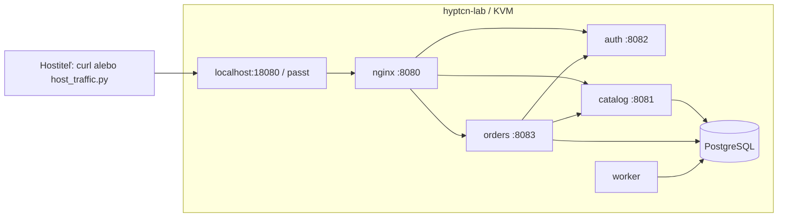

# Trvalo bežiace serverové laboratórium

`make lab-up` spustí VM `hyptcn-lab`, nasadí služby a zapne premávku z hostiteľa.
HTTP vstup je **http://127.0.0.1:18080**. Nasadenie možno zopakovať; objednávky
sa pri ňom zachovajú. `make lab-stop` zastaví generátor a požiada VM o vypnutie.



Auth vydáva podpísaný demo token, katalóg číta produkty z databázy, orders
overuje token cez auth a cenu cez catalog. Objednávku uloží do PostgreSQL.
Samostatný worker ju zmení z `pending` na `completed`. `/healthz` kontroluje
databázu, obe závislé API aj čerstvosť heartbeat workera; samotný bežiaci nginx
pre úspešný výsledok nestačí.

Demo identity nemajú heslá. Presmerovaný port je viazaný na loopback hostiteľa.
Je to benígna aplikácia na vytváranie záťaže, nie verejná obchodná služba.
Databáza a interné API počúvajú len vo VM. Dokončené objednávky staršie ako deň
worker priebežne odstraňuje. Logy laboratória nginx neobsluhuje systémový
logrotate; segmenty uzatvára zberový runner medzi meraniami (nižšie).

## Spustenie na tomto stroji

```sh
cd hyptcn3   # koreň repozitára
make lab-up
make lab-status
make lab-test
curl -fsS http://127.0.0.1:18080/healthz
curl -fsS http://127.0.0.1:18080/api/catalog
```

Pri prvom spustení sa zo **zastavenej** existujúcej domény `hyptcn-guest`
urobí samostatná kópia disku cez `qemu-img convert`. Nový disk je
`vms/hyptcn-lab.qcow2` a nemá závislosť na pôvodnom disku. Experimentálna
doména, jej snapshot `hyptcn-clean` a pôvodné merania sa nemenia.
Zdroj musí obsahovať Debian s qemu-guest-agentom; tento repozitár jeho
existujúci lokálny disk nedistribuuje. Definovanie čistej VM na inom počítači
cez pôvodný cloud-init zostáva samostatný krok v `harness/README.md`.

Na zberovom PC (2026-10-20) bol disk hosťa zväčšený z 3 GiB na 20 GiB
(`qemu-img resize` pri vypnutej VM, potom `growpart` a `resize2fs` v hosťovi).
Pôvodných 899 MB voľného miesta by nestačilo na rast PostgreSQL a WAL počas
dlhej kampane. Disk VM potom presunul na pracovný SSD:
`/mnt/ssd/hyptcn3-work/vms/hyptcn-lab.qcow2` (kópia pri vypnutej VM, zhodná
SHA-256 aj `qemu-img check`; libvirt definícia ukazuje na novú cestu).
Kópia z HDD zostala ako `vms/hyptcn-lab.qcow2.hdd-backup-20261020` a už sa
neaktualizuje.

2026-10-21 sa disk VM vrátil na systémový HDD: `vms/hyptcn-lab.qcow2`
(kópia pri vypnutej VM, zhodná SHA-256, `qemu-img check` bez chýb; libvirt
definícia ukazuje na túto cestu). Kópia zo SSD zostala ako
`/mnt/ssd/hyptcn3-work/vms/hyptcn-lab.qcow2.ssd-copy-20261021`. Dôvodom bol
pilot, v ktorom disk VM zdieľal súborový systém ext4 (`sda2`) so snímkami.
Plná snímka (~920 MiB) zostala asi dve minúty v page cache a potom sa
zapísala naraz. Commity databázy hosťa (fsync obrazu disku) čakali v tom
istom žurnále za týmto zápisom a štyri požiadavky prekročili limit klienta
4 s ([záznam](../data/results/collection_io_interference_20261021.json)).
Snímky, logy a príznaky zostávajú na SSD; disk hosťa je teraz na inom
zariadení aj súborovom systéme. Rovnaký mechanizmus zastavil aj monitor
hostiteľa: jeho `fsync` každých 60 s čakal počas takého zápisu a monitor
vynechal vzorky (medzera 3 s, audit hranicu 2,5 s). Monitor preto počas
vzorkovania `fsync` nevolá; synchronizuje až koncový záznam. Zapisovač logov
premávky robí `fsync` vo vlastnom vlákne za frontou 50 000 záznamov.

Monitor napriek tomu vynechával jednotlivé vzorky počas spätného zápisu plnej
snímky na SSD: v session kampaní `benign-v2-20261022` a `benign-v3-20261022`
vznikli 2 s medzery (najviac 2,04 s, hranica auditu 2,5 s). Oneskorenie
nastalo až po načítaní čítačov z `/proc`, v rovnakom okamihu, keď sa
predĺžil zápis delta snímky zberača (session 3 kampane v3, snímka 26:
čítanie 877 ms, spolu 1904 ms;
[záznam](../data/results/collection_campaign_benign_v3_20261022.json)).
Od 2026-10-22 preto riadky monitora
zapisuje samostatné vlákno z fronty a vzorkovanie na zápis nečaká.

Limit klienta generátora je od toho istého dňa 10 s namiesto 4 s:
najpomalšia benígna požiadavka mala 2,35 s
(`POST /api/orders`, profil `bursty`, disk VM na HDD) a požiadavka prerušená
klientom by sama zanechala v hosťovi záznam 499 a traceback služby. Limit
teraz zachytí iba zaseknutý server; latencia každej požiadavky je v logu.

Hostiteľ má `vm.swappiness = 1` (`/etc/sysctl.d/90-hyptcn3-collection.conf`,
od 2026-10-21). Pri pôvodnej hodnote 60 a swape na systémovom HDD (`sdb3`)
jadro počas veľkého I/O (audit, archív, zápis snímok) odložilo nečinnú RAM
hosťa. Pred tým istým pilotom mala QEMU vo swape 331 228 kB a prvá plná
snímka ich čítala späť 7,3 s pri perióde 5 s; jeden slot vypadol. Zberový
runner preto pred zahrievaním načíta späť rozsahy procesu QEMU, ktoré majú
odswapované stránky (krok `prefault`, iba čítanie cez `/proc/PID/mem` ako
root; 2 GiB rezidentnej RAM za 0,35 s). Do `session.json` zapisuje
`vm_swappiness` a swap QEMU; kampaň hodnotu swappiness zmrazí s pilotom.

Libvirt 11 pri vypnutí hostiteľa VM session démona uloží (`reason=saved`
v `~/.cache/libvirt/qemu/log/hyptcn-lab.log`) a pri ďalšom štarte démona ju
obnoví (`-incoming defer`). Obnovená VM má rovnaký boot ID, ale iný proces
QEMU a do zásahu NTP aj zastarané hodiny. Zberový runner preto zaznamenáva
identitu procesu QEMU a pred meraním kontroluje posun hodín hosťa. Kampaň
identitu procesu uloží pri vzniku bootovej skupiny; obnovená alebo
reštartovaná VM uprostred skupiny kampaň zastaví pred ďalšou session.

Plná snímka číta všetky stránky, ktoré hostiteľ hosťovi pridelil. Reštart
hosťa ich hostiteľovi nevráti a nový boot sa dotkne ďalších, takže na jednom
procese QEMU plná snímka s reštartmi rastie: od 2026-10-22 00:12 UTC zo 118
na 271 tisíc stránok z 524 tisíc a z 1,7 na 2,7 s
([záznam](../data/results/collection_full_snapshot_growth_20261022.json)).
Pred `campaign.py init` sa preto VM vypne a znova spustí, čím vznikne nový
proces QEMU:

```sh
.venv/bin/python scripts/labctl.py stop     # potom čakať na `virsh -c qemu:///session domstate hyptcn-lab` = shut off
.venv/bin/python scripts/labctl.py start
.venv/bin/python scripts/labctl.py status
```

Počas kampane to nerobiť: kampaň zmenu procesu uprostred skupiny zastaví.

Požiadavky hostiteľa: KVM, libvirt s používateľskou session, `virsh`,
`qemu-img`, `passt`, Python a používateľský systemd. Vo VM treba nginx,
PostgreSQL, Python a `python3-psycopg2`. Chýbajúci databázový ovládač pre Debian
sa stiahne na hostiteľa podľa URL a SHA-256 v `lab/dependencies.json` a odošle
cez guest-agent. Ostatné chýbajúce serverové balíky inštaluje hosť cez apt.

Sieť používa libvirt `interface type=user` s backendom `passt` a presmerovaním
TCP portu hostiteľa na nginx vo VM. Hostiteľský most ani root na túto sieť
netreba. Je to skutočné HTTP cez sieťový adaptér VM; požiadavky nespracúva
hostiteľská náhrada služieb. Nastavenie vychádza z
[libvirt Domain XML](https://libvirt.org/formatdomain.html#userspace-connection-using-slirp).
Toto laboratórium nie je izolované prostredie na spúšťanie malvéru.

## Premávka a ovládanie

`make lab-up` vytvorí používateľskú službu `hyptcn-lab-traffic.service`.
Tá beží aj po skončení terminálu, pokiaľ beží používateľský systemd.
Hosťovské služby sa spúšťajú pri boote VM; po reštarte hostiteľa spusti znovu
`make lab-up`. Trvalý autostart hostiteľskej služby sa neinštaluje.

```sh
# Stav a log hostiteľského generátora
cat data/lab/traffic.json
journalctl --user -u hyptcn-lab-traffic -n 30 --no-pager

# Zastaviť iba premávku; VM a API zostanú bežať
make lab-traffic-stop
python3 scripts/labctl.py traffic-start

# Ďalší ohraničený beh s vlastným seed a počtom klientov
python3 scripts/host_traffic.py --profile lab --target http://127.0.0.1:18080 \
  --dur 60 --seed 42 --vlakien 8 --burst 0.5 --out data/lab/manual-traffic.json

# Správa služieb vo VM cez guest-agent
python3 scripts/labctl.py logs
python3 scripts/labctl.py exec --guest-command 'systemctl status hyptcn-lab@orders --no-pager'
```

Generátor mieša čítanie katalógu, čítanie objednávok, vytváranie objednávok
a health kontroly. Každé vlákno má vlastný seedovaný generátor; súbežné
plánovanie a presné časovanie sa medzi behmi môžu líšiť. Je to uzavretý
cyklus klientov (každý pracovník posiela jednu požiadavku, potom čaká), nie
pevná frekvencia požiadaviek. Stavový JSON (`--out`) obsahuje skutočný čas
behu, počty úspechov a chýb, HTTP statusy a počty podľa ciest. Pole
`latency_recent_p95_ms` je iba posuvné okno posledných 10 000 požiadaviek,
nie p95 celej session. Pri SIGTERM generátor dokončí rozpracované požiadavky
a zapíše záverečné počty. HTTP chyby znamenajú nenulový návratový kód.

So `--requests-log` a `--intervals-log` vznikne úplný append-only záznam
(`scripts/traffic_log.py summarize` ho skontroluje):

- jeden JSONL riadok na požiadavku: request ID, pracovník, fáza
  (`warmup`/`measure`/`post` podľa času začiatku), metóda, cesta bez parametrov,
  HTTP status alebo transportná chyba či timeout, UTC začiatok a koniec,
  trvanie z monotónnych hodín; tokeny ani telá odpovedí sa neukladajú;
- 5 s intervaly s počtami podľa výsledku, statusu a cesty, skutočným trvaním
  intervalu, priepustnosťou a histogramom latencií (logaritmické koše po 5 %,
  hornou hranicou koša sa percentil nadhodnotí najviac o 5 %); požiadavka patrí
  intervalu, v ktorom začala; histogramy sa zlučujú sčítaním;
- hlavičku s konfiguráciou a definíciami a záverečný záznam s počtami.
  Chýbajúci záverečný záznam alebo neukončený posledný riadok znamená neúplný log.

Latencie vo všetkých percentiloch zahŕňajú aj neúspešné požiadavky; súhrn
uvádza aj percentily iba úspešných. Celobežné percentily sa počítajú z úplného
záznamu, nikdy priemerovaním intervalových hodnôt. SIGUSR1 prepne fázu na
`measure`, SIGUSR2 na `post`. Chyba zápisu logu zastaví generátor s kódom 3.

## Logy servera a korelačné ID

Každá požiadavka generátora nesie hlavičku `X-Request-ID`. Nginx ju zapíše do
JSON access logu (`/var/log/hyptcn-lab/nginx-access.jsonl`: čas, status,
`request_time`, časy upstreamu, pôvodné aj preposlané ID) a pošle ďalej
službám. Orders ho posiela aj vo vlastných interných volaniach auth a catalog.
Každá služba zapíše jeden riadok do journalu s ID, metódou, cestou a statusom.
Prenos ID cez celú cestu bol overený skutočnými požiadavkami 2026-10-20.

Runner medzi meraniami uzatvára segmenty logov cez
`python3 scripts/labctl.py segment --label L --dest DIR`. Pomocník v hosťovi
(`lab/guest_state.py`) súbor premenuje, pošle nginx signál na znovuotvorenie
a overí, že ho už žiadny proces nemá otvorený. Potom spočíta SHA-256
a počet riadkov a kópiu skomprimuje. Hostiteľ po prenose overí kontrolné
súčty a až potom sa kópia v hosťovi zmaže. `labctl journal` rovnako prenesie
journal hosťa za zvolený interval, `labctl state` vypíše stav služieb, počty
reštartov, stav databázy, NTP a disk, `labctl clock` posun hodín hosťa.
Qemu-guest-agent tu slúži orchestrácii a zberu dôkazov; RAM číta hostiteľský
zberač.

V hosťovi sú vypnuté časovače `apt-daily`, `apt-daily-upgrade`, `man-db`,
`fstrim`, `e2scrub_all`, `logrotate` a `dpkg-db-backup`; statický
`systemd-tmpfiles-clean.timer` (15 min po boote, potom denne) je maskovaný.
Údržba a aktualizácie nie sú súčasťou modelu záťaže a menili by prostredie
počas kampane. Revízia 2026-10-21 zistila, že posledné tri časovače ešte bežali:
`systemd-tmpfiles-clean` by spadol do prvej session každej bootovej skupiny,
`logrotate` a `dpkg-db-backup` o polnoci. Logy laboratória `logrotate`
nerotuje (sú mimo `/var/log/nginx/`). Identita hosťa obsahuje zoznam
aktívnych časovačov, takže znovu zapnutý časovač (najneskôr po reštarte
skupiny) zmení prostredie a kampaň zastaví pred ďalšou session.

Incident 2026-10-20: adresár logov mal najprv práva `0750`. Pracovné procesy
nginx (`www-data`) preto po uzavretí segmentu nemohli log znovu otvoriť
a písali ďalej do premenovaného súboru, ktorý sa po prenose zmazal. Kontrola
párovania request ID to zachytila pred meraním. Riadky boli zachránené
z otvorených deskriptorov (`data/diagnostics/recovered-nginx-20261020/`).
Adresár má teraz `0755` a uzavretie segmentu zlyhá, ak ho nejaký proces ešte
drží otvorený.

Ručné vytvorenie objednávky:

```sh
TOKEN=$(curl -fsS http://127.0.0.1:18080/api/auth/token \
  -H 'Content-Type: application/json' -d '{"user":"demo"}' | python3 -c 'import json,sys; print(json.load(sys.stdin)["token"])')
curl -fsS http://127.0.0.1:18080/api/orders \
  -H "Authorization: Bearer $TOKEN" -H 'Content-Type: application/json' \
  -d '{"product_id":1,"quantity":2}'
curl -fsS http://127.0.0.1:18080/api/orders -H "Authorization: Bearer $TOKEN"
```

## RAM introspekcia a model

```sh
# Pevný počet snímok pri perióde nastavenej skriptom; sudo potrebuje eBPF.
sudo scripts/lab_capture.sh 24

# Zo vzniknutého adresára vytvor príznaky s existujúcim profilom jadra.
python3 -m features session --snapshot data/raw/ADRESAR_ZBERU \
  --profile profiles/debian12-6.1.0-42-cloud-amd64 \
  --out data/lab/server-session.npz
```

Zber nevracia snapshot VM, nemení jej disk ani ju po dokončení nevypína.
Zapisuje snímky, log kolektora, stav HTTP premávky pred/po a manifest do
`data/raw/`, ktoré je mimo gitu. Počet snímok overuje proti požadovanému počtu.
Pri chybe alebo prerušení ukončí vlastný kolektor a vráti vlastníctvo
artefaktov používateľovi. Pri dlhých behoch treba plánovať miesto na disku;
skript historické snímky automaticky nemaže.

Agent vo VM sa používa na nasadenie a správu aplikácie. Čítanie RAM vykonáva
existujúci hostiteľský eBPF kolektor. Oba mechanizmy sú odlišné a pôvod
profilu jadra zostáva priznanou vstupnou závislosťou.

Existujúci checkpoint z krátkych idle sedení nie je kalibrácia pre toto
serverové prostredie. Na tvrdenie o detekcii treba samostatné benígne tréningové,
kalibračné a testovacie sedenia. Laboratórium samo nedokazuje FAR/h,
citlivosť, odolnosť ani dlhodobé časové vlastnosti detektora.

Živý zber odhalil aj chybu v príznakoch: KASLR preukotvenie sa predtým robilo
len v CLI parsera. Teraz ho vykonáva aj `features.snapshot` pred čítaním
objektov; nevyriešený nesúlad znamená chybu. Staršie príznaky z iných bootov
mohli obsahovať neúplné počty a nulové sokety. Pred ďalším tréningom ich treba
vypočítať znova. Starý checkpoint slúži iba na mechanické overenie skórovania.

V `scripts/detektor.py` boli opravené tri chyby prepojenia: slicing `deque`
pri alarme, ignorovanie uloženej dĺžky okna a neplatné argumenty `hold`.
Detektor zachová reťazce celého vstupného okna a po medzere v poradí snímok
okno znovu naplní. `alarm.json` je výstup standalone detektora; týmto sa
automaticky nevolá C reakčný hook. Lokalizácia po binoch a kernelové
invarianty ešte nie sú súčasťou tohto standalone alarmu.

## Overenie

`make test` spustí C aj Python testy. `make check` kontroluje tvrdenia
a generovanú príručku. Hostiteľské Python závislosti sú v `requirements.txt`;
na bežné ovládanie laboratória a generovanie HTTP stačí štandardná knižnica.

`make lab-test` vykoná HTTP kontrolu cez hostiteľský port, overí odmietnutie
neplatného tokenu a neplatnej objednávky, vytvorí objednávku a počká na
workera. Uloží nový artefakt `data/results/lab_smoke_*.json` s identifikáciou
kódu a nameranými odpoveďami. Ide o funkčnú kontrolu aplikácie, nie
meranie kvality detekcie. Živé štatistiky v `data/lab/traffic.json` sa menia
a pre citovanie výsledku ich treba zachovať v samostatnom artefakte.
